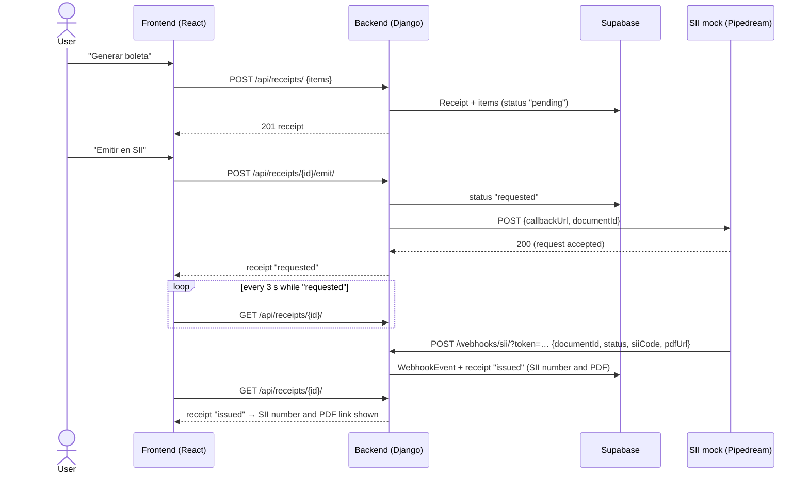

# Carrito Feliz 🛒

> 🇨🇱 [Versión en español](README.md)

A small neighborhood e-commerce app. It keeps a product catalog, builds a cart and generates receipts ("boletas") with automatic 15% tax. It also shows the receipt history and issues receipts through an external service that simulates Chile's tax authority (SII), which replies by **webhook**.

Full-stack technical test for Carvuk ([statement, in Spanish](https://carvuk.notion.site/prueba-tecnica-full)).

## Features

| Requirement | Status |
| --- | --- |
| Product catalog (create, detail, edit, delete) with sample products | ✅ |
| Front-end cart: add, change quantities, remove | ✅ |
| Generate a receipt with gross amount, 15% tax and net amount | ✅ |
| Receipt history and detail with products, net, tax and total | ✅ |
| Fixed 15% tax, always computed in one place (backend) | ✅ |
| **Supabase** database (Postgres) | ✅ |
| **Bonus 1:** authentication with **Clerk** | ✅ |
| **Bonus 2:** asynchronous issuing via external API + webhook (SII number and PDF link in the history) | ✅ |

## Stack

| Layer | Technology |
| --- | --- |
| Frontend | React 19, TypeScript, Vite, React Router, TanStack Query, `@clerk/react`, Vitest |
| Backend | Python 3.12, Django 6, Django REST Framework, PyJWT (Clerk token verification) |
| Database | Supabase (Postgres) through `DATABASE_URL` (SQLite as local/test fallback) |
| Integration | SII mock on Pipedream + our own webhook, tunneled with cloudflared / ngrok |

## Project structure

```
.
├── backend/
│   ├── config/              # settings (everything from env vars), urls
│   └── store/
│       ├── models.py        # Product, Receipt, ReceiptItem, WebhookEvent
│       ├── services/        # tax.py (15% rule), receipts.py (create receipt), sii.py (request issuing)
│       ├── views.py         # REST API for products, receipts and tax
│       ├── webhooks.py      # POST /webhooks/sii/
│       ├── authentication.py# Clerk JWT verification
│       └── tests/           # 32 tests (no network: Pipedream and Clerk are mocked)
└── frontend/
    └── src/
        ├── api/             # typed client + React Query hooks
        ├── auth/            # ClerkProvider and sign-in screen
        ├── cart/            # cart state (reducer + localStorage)
        ├── components/      # layout, dialogs, badges, totals…
        ├── lib/             # CLP and date formatting, totals calculation
        └── pages/           # Catalog, Product, Cart, Receipts, Receipt detail
```

## Running locally

**Requirements:**
- Python 3.12+ and Node.js 20+.
- A Supabase project (optional: SQLite is used without it).
- A Clerk application (optional: the app runs without login without it).

### 1. Backend (http://127.0.0.1:8000)

```bash
cd backend
python -m venv .venv
# Windows: .venv\Scripts\activate    |    macOS/Linux: source .venv/bin/activate
pip install -r requirements.txt
cp .env.example .env        # fill in DATABASE_URL and the rest (see table below)
python manage.py migrate    # creates the tables and loads the sample products
python manage.py runserver
```

To use the Django admin at http://127.0.0.1:8000/admin/ (receipts, products and the webhook log), first run `python manage.py createsuperuser`.

### 2. Frontend (http://localhost:5173)

```bash
cd frontend
npm install
cp .env.example .env        # VITE_CLERK_PUBLISHABLE_KEY (optional)
npm run dev
```

Vite proxies `/api/*` to the backend on `127.0.0.1:8000`, so both servers must be running.

### 3. Tests

```bash
cd backend && python manage.py test          # 32 tests
cd frontend && npm test && npm run lint && npm run build
```

### Environment variables

**`backend/.env`**

| Variable | Description |
| --- | --- |
| `DEBUG` | `True` locally. With `DEBUG`, tunnel hosts (`*.trycloudflare.com`, `*.ngrok-free.app`) are accepted. |
| `SECRET_KEY` | Django secret key. |
| `DATABASE_URL` | Supabase connection string (*Project Settings → Database*). SQLite if missing. |
| `ALLOWED_HOSTS`, `CORS_ALLOWED_ORIGINS`, `CSRF_TRUSTED_ORIGINS` | Allowed hosts and origins (comma separated). |
| `SII_API_URL` | SII mock endpoint: `https://eoej5sf0r8zkoh2.m.pipedream.net`. |
| `PUBLIC_BASE_URL` | Public backend URL (tunnel or production), used to build the `callbackUrl`. **Empty = issuing disabled.** |
| `SII_WEBHOOK_TOKEN` | Shared secret sent in the `callbackUrl` and checked by the webhook. |
| `AUTH_ENABLED` | `True` to require a Clerk session on the API. |
| `CLERK_PUBLISHABLE_KEY` | Clerk publishable key; the JWKS URL is derived from it. |

**`frontend/.env`**

| Variable | Description |
| --- | --- |
| `VITE_CLERK_PUBLISHABLE_KEY` | Clerk publishable key. If empty, the app runs without login (dev mode). |
| `VITE_API_URL` | API base URL. Defaults to `/api` (Vite proxy). |

## Bonus 2: issuing receipts with the SII via webhook

### Flow



**Request and callback**
- **`documentId`** is the receipt `id`.
- **`callbackUrl`** is `PUBLIC_BASE_URL + /webhooks/sii/?token=<SII_WEBHOOK_TOKEN>`.

**How the webhook behaves**
- **Access:** it is public, because Pipedream can't authenticate with Clerk. The token in the `callbackUrl` protects it: without the token it returns `403`.
- **Logging:** every call is stored as a `WebhookEvent`, visible in the Django admin, including rejected calls.
- **Errors:** an unknown `documentId` returns `404`, and an invalid payload returns `400`.
- **Repeats:** it is idempotent, so a repeated call leaves the receipt unchanged.

**When the request to Pipedream fails**, the receipt is marked `failed`, keeps the error and shows a **"Reintentar emisión"** (retry) button.

### Local step-by-step

1. Start the backend and frontend as described above.
2. Open a public tunnel to the backend, with either tool:
   ```bash
   # cloudflared (no account needed). Windows: winget install Cloudflare.cloudflared
   cloudflared tunnel --url http://localhost:8000
   # or ngrok (needs an authtoken)
   ngrok http 8000
   ```
3. Put the tunnel URL (e.g. `https://xxxx.trycloudflare.com`) in `backend/.env`:
   ```env
   PUBLIC_BASE_URL=https://xxxx.trycloudflare.com
   SII_WEBHOOK_TOKEN=any-secret
   ```
   Then restart `runserver`, because `.env` is read at startup.
4. Check that the tunnel reaches the backend:
   ```bash
   curl https://xxxx.trycloudflare.com/api/tax/
   ```
   It should return `{"rate":0.15}`. With Clerk enabled it returns `401` instead, which still confirms the tunnel works.
5. In the app, fill a cart, click **"Generar boleta"**, then **"Emitir en SII"** on the receipt detail. The status changes to *Emitiendo…*.
6. The mock calls the webhook after about a minute. Without reloading, the receipt becomes **Emitida** and shows the **SII number** and **PDF** in both the detail and the history.
7. To inspect what arrived, open http://127.0.0.1:8000/admin/store/webhookevent/.

> The mock allows few requests (100 in total). That's why issuing is **not** triggered automatically when a receipt is created; it's requested with the button. The tests mock Pipedream and never call it.

### Evidence from a real run (2026-10-15, local with cloudflared)

1. **Webhook without a token:** got `403`, logged as `WebhookEvent #1` with the error "Token inválido".
2. **Receipt #2** (2 × Leche + 1 × Aceite): gross $4.200, tax $630, net $3.570. "Emitir en SII" set it to `requested` at 16:33:40 (UTC-3).
3. **Pipedream's webhook arrived at 16:34:31.** It is `WebhookEvent #2`, processed:
   ```json
   {
     "documentId": 2,
     "status": "issued",
     "siiCode": "SII-2",
     "pdfUrl": "https://www.rd.usda.gov/sites/default/files/pdf-sample_0.pdf"
   }
   ```
4. **Result:** receipt #2 is `issued`, with SII number `SII-2` and the PDF link shown in the history.

## Bonus 1: authentication with Clerk

**Frontend**
- When `VITE_CLERK_PUBLISHABLE_KEY` is set, the app is wrapped in `ClerkProvider`.
- Signed-out users see Clerk's `SignIn`; signed-in users get a `UserButton` in the header.
- Every API request carries `Authorization: Bearer <session token>`.

**Backend** (`store/authentication.py`)
- Verifies the JWT's RS256 signature with the Clerk instance's public keys (JWKS), derived from the publishable key.
- Checks expiry, and that `azp` (the origin that requested the token) is in `CORS_ALLOWED_ORIGINS`.
- With `AUTH_ENABLED=True` the whole API requires a session, except the webhook.

**To enable it**
1. Create an application at [dashboard.clerk.com](https://dashboard.clerk.com).
2. Put its publishable key in `frontend/.env` (`VITE_CLERK_PUBLISHABLE_KEY`).
3. Put the same key in `backend/.env` (`CLERK_PUBLISHABLE_KEY`), along with `AUTH_ENABLED=True`.

## API

| Method | Path | Description |
| --- | --- | --- |
| GET / POST | `/api/products/` | List / create products |
| GET / PATCH / PUT / DELETE | `/api/products/{id}/` | Product detail / edit / delete |
| GET | `/api/tax/` | Current tax rate (`{"rate": 0.15}`) |
| GET | `/api/receipts/` | Current user's receipt history (newest first) |
| POST | `/api/receipts/` | Create a receipt: `{"items": [{"product_id": 1, "quantity": 2}]}` |
| GET | `/api/receipts/{id}/` | Receipt detail |
| POST | `/api/receipts/{id}/emit/` | Request (or retry) SII issuing |
| POST | `/webhooks/sii/?token=…` | SII webhook (public, token-protected) |

## Assumptions and decisions

**Money and tax**
- Prices are whole CLP and **already include tax**, so the cart total is the gross amount the customer pays.
- Tax is 15% of the gross amount, **rounded to the nearest peso** (half up). Net is gross − tax.
- That rule lives only in the backend (`services/tax.py`). The frontend only uses it for the cart preview, with the rate from `/api/tax/`.
- When a receipt is created it stores its totals, plus each item's name and price at that moment. Later product changes or deletions don't alter existing receipts.

**Cart**
- The cart lives in the frontend, as the statement allows, and is saved to `localStorage` so a reload doesn't lose it.
- If the same product appears twice in one request, the quantities are merged.
- If a product's price changes after it was added, the cart shows the current price with a notice, and the receipt uses that current price.
- A deleted product in the cart is flagged, and the receipt can't be generated until it is removed.

**SII issuing**
- Issuing is **manual**, via the "Emitir en SII" button. This avoids spending the mock's 100-request limit on every receipt, and allows retries.
- Any webhook `status` other than `issued` marks the receipt `failed`, with the details.

**Users**
- **The app is the store's administrator view** (backoffice), not a storefront for end customers. That's why signed-in users can create, edit and delete products as well as build carts and generate receipts. There are no roles: every signed-in user is an administrator.
- With Clerk enabled, **each user only sees their own receipts**: the Clerk user `id` is stored in `created_by`. There is no local user table; Clerk is the source of truth.
- Receipts created while auth was disabled have no user, so they don't show up once Clerk is enabled.
- The catalog belongs to the store: all administrators see and edit the same products.

**Sample data**
- The sample products (milk, bread, oil, rice, eggs, sugar, pasta and coffee) are loaded by a data migration when running `migrate`.
