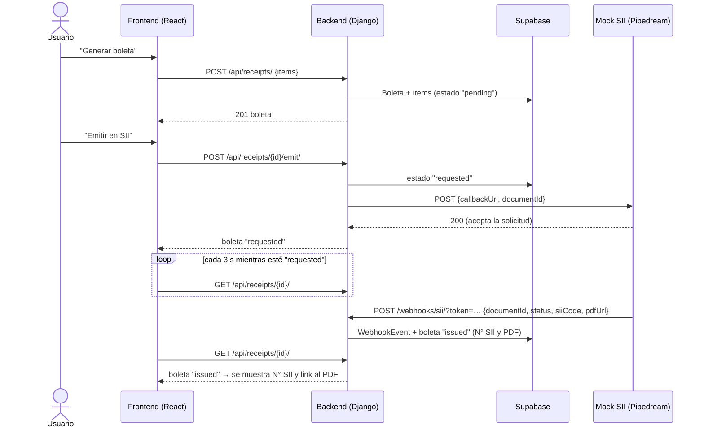

# Carrito Feliz 🛒

> 🇬🇧 [English version](README.en.md)

Mini e-commerce de barrio para mantener un catálogo de productos, armar un carrito, generar boletas con impuesto automático (15 %), revisar su historial y emitirlas en un servicio externo que simula al SII y responde por **webhook**.

Prueba técnica full-stack para Carvuk ([enunciado](https://carvuk.notion.site/prueba-tecnica-full)).

## Funcionalidades

| Requisito | Estado |
| --- | --- |
| Catálogo de productos (crear, ver detalle, editar, eliminar) con productos de ejemplo | ✅ |
| Carrito en el front: agregar, cambiar cantidades, quitar | ✅ |
| Generar boleta con valor bruto, impuesto 15 % y valor neto | ✅ |
| Historial de boletas y detalle con productos, neto, impuesto y total | ✅ |
| Impuesto fijo de 15 %, calculado siempre en el mismo lugar (backend) | ✅ |
| Base de datos en **Supabase** (Postgres) | ✅ |
| **Bonus 1:** autenticación con **Clerk** | ✅ |
| **Bonus 2:** emisión asíncrona con API externa + webhook (N° SII y link PDF en el historial) | ✅ |

## Stack

| Capa | Tecnología |
| --- | --- |
| Frontend | React 19, TypeScript, Vite, React Router, TanStack Query, `@clerk/react`, Vitest |
| Backend | Python 3.12, Django 6, Django REST Framework, PyJWT (verificación de tokens Clerk) |
| Base de datos | Supabase (Postgres) mediante `DATABASE_URL` (SQLite como respaldo local y en tests) |
| Integración | Mock del SII en Pipedream + webhook propio, túnel con cloudflared / ngrok |

## Estructura

```
.
├── backend/
│   ├── config/              # settings (todo por variables de entorno), urls
│   └── store/
│       ├── models.py        # Product, Receipt, ReceiptItem, WebhookEvent
│       ├── services/        # tax.py (regla del 15 %), receipts.py (crear boleta), sii.py (solicitar emisión)
│       ├── views.py         # API REST de productos, boletas e impuesto
│       ├── webhooks.py      # POST /webhooks/sii/
│       ├── authentication.py# verificación del JWT de Clerk
│       └── tests/           # 32 tests (sin red: Pipedream y Clerk se simulan)
└── frontend/
    └── src/
        ├── api/             # cliente tipado + hooks de React Query
        ├── auth/            # ClerkProvider y pantalla de login
        ├── cart/            # estado del carrito (reducer + localStorage)
        ├── components/      # layout, diálogos, badges, totales…
        ├── lib/             # formato CLP, fechas, cálculo de totales
        └── pages/           # Catálogo, Producto, Carrito, Boletas, Detalle de boleta
```

## Levantar en local

**Requisitos:** Python 3.12+, Node.js 20+, un proyecto de Supabase (opcional: sin él se usa SQLite) y una aplicación de Clerk (opcional: sin ella la app funciona sin login).

### 1. Backend (http://127.0.0.1:8000)

```bash
cd backend
python -m venv .venv
# Windows: .venv\Scripts\activate    |    macOS/Linux: source .venv/bin/activate
pip install -r requirements.txt
cp .env.example .env        # completar DATABASE_URL y el resto (ver tabla abajo)
python manage.py migrate    # crea las tablas y carga los productos de ejemplo
python manage.py runserver
```

Opcional: `python manage.py createsuperuser` para entrar al admin en http://127.0.0.1:8000/admin/ (boletas, productos y el log de webhooks).

### 2. Frontend (http://localhost:5173)

```bash
cd frontend
npm install
cp .env.example .env        # VITE_CLERK_PUBLISHABLE_KEY (opcional)
npm run dev
```

Vite redirige `/api/*` al backend en `127.0.0.1:8000`, así que ambos servidores deben estar corriendo.

### 3. Tests

```bash
cd backend && python manage.py test          # 32 tests
cd frontend && npm test && npm run lint && npm run build
```

### Variables de entorno

**`backend/.env`**

| Variable | Descripción |
| --- | --- |
| `DEBUG` | `True` en local. Con `DEBUG` se aceptan hosts de túneles (`*.trycloudflare.com`, `*.ngrok-free.app`). |
| `SECRET_KEY` | Clave secreta de Django. |
| `DATABASE_URL` | Connection string de Supabase (*Project Settings → Database*). Si falta, se usa SQLite. |
| `ALLOWED_HOSTS`, `CORS_ALLOWED_ORIGINS`, `CSRF_TRUSTED_ORIGINS` | Hosts y orígenes permitidos (separados por coma). |
| `SII_API_URL` | Endpoint del mock del SII: `https://eoej5sf0r8zkoh2.m.pipedream.net`. |
| `PUBLIC_BASE_URL` | URL pública del backend (túnel o producción) con la que se arma el `callbackUrl`. **Vacía = emisión deshabilitada.** |
| `SII_WEBHOOK_TOKEN` | Secreto compartido que viaja en el `callbackUrl` y que el webhook valida. |
| `AUTH_ENABLED` | `True` para exigir sesión de Clerk en la API. |
| `CLERK_PUBLISHABLE_KEY` | Publishable key de Clerk; de ella se obtiene la URL de las llaves públicas (JWKS). |

**`frontend/.env`**

| Variable | Descripción |
| --- | --- |
| `VITE_CLERK_PUBLISHABLE_KEY` | Publishable key de Clerk. Si está vacía, la app corre sin login (modo desarrollo). |
| `VITE_API_URL` | URL base de la API. Por defecto `/api` (proxy de Vite). |

## Bonus 2: emisión en el SII por webhook

### Flujo



- **`documentId`** es el `id` de la boleta, y **`callbackUrl`** es `PUBLIC_BASE_URL + /webhooks/sii/?token=<SII_WEBHOOK_TOKEN>`.
- El webhook es público, porque Pipedream no puede autenticarse con Clerk. Lo protege el token del `callbackUrl`: sin él responde `403`.
- Cada llamada queda registrada en `WebhookEvent`, que se ve en el admin de Django, incluidas las rechazadas.
- El webhook es idempotente: si llega dos veces, la boleta no cambia.
- Si el `documentId` no existe, responde `404`, y si el payload es inválido, `400`.
- Si la solicitud a Pipedream falla, la boleta queda en `failed` con el error y el botón **"Reintentar emisión"**.

### Paso a paso para probarlo en local

1. Levanta backend y frontend como se indica arriba.
2. Abre un túnel público hacia el backend. Cualquiera de los dos sirve:
   ```bash
   # cloudflared (no requiere cuenta). Windows: winget install Cloudflare.cloudflared
   cloudflared tunnel --url http://localhost:8000
   # o ngrok (requiere authtoken)
   ngrok http 8000
   ```
3. Copia la URL que entrega el túnel (por ejemplo `https://xxxx.trycloudflare.com`) en `backend/.env`:
   ```env
   PUBLIC_BASE_URL=https://xxxx.trycloudflare.com
   SII_WEBHOOK_TOKEN=un-secreto-cualquiera
   ```
   Luego reinicia `runserver`, porque `.env` se lee al iniciar.
4. Comprueba que el túnel llega al backend. Debe responder `{"rate":0.15}` (si Clerk está activo responde `401`, que también confirma que llega):
   ```bash
   curl https://xxxx.trycloudflare.com/api/tax/
   ```
5. En la app, arma un carrito, presiona **"Generar boleta"** y luego **"Emitir en SII"** en el detalle. El estado pasa a *Emitiendo…*.
6. El mock responde por webhook en aproximadamente 1 minuto. Sin recargar, la boleta pasa a **Emitida** y muestra el **N° SII** y el **PDF**, tanto en el detalle como en el historial.
7. Para revisar lo que llegó, entra a http://127.0.0.1:8000/admin/store/webhookevent/.

> El mock admite pocas solicitudes (100 en total). Por eso la emisión **no** se dispara sola al crear la boleta: se pide con el botón. Además, los tests simulan Pipedream y nunca lo llaman.

### Evidencia de la prueba real (15-10-2026, desde local con cloudflared)

1. **Webhook sin token:** respondió `403`, y quedó registrado como `WebhookEvent #1` con el error "Token inválido".
2. **Boleta #2** (2 × Leche + 1 × Aceite):
   - Bruto $4.200, impuesto $630, neto $3.570.
   - "Emitir en SII" la dejó en `requested` a las 16:33:40.
3. **El webhook de Pipedream llegó a las 16:34:31.** Es el `WebhookEvent #2`, procesado:
   ```json
   {
     "documentId": 2,
     "status": "issued",
     "siiCode": "SII-2",
     "pdfUrl": "https://www.rd.usda.gov/sites/default/files/pdf-sample_0.pdf"
   }
   ```
4. **Resultado:** la boleta #2 quedó `issued` con N° SII `SII-2` y el link al PDF, visibles en el historial.

## Bonus 1: autenticación con Clerk

**Frontend**
- Si existe `VITE_CLERK_PUBLISHABLE_KEY`, la app se envuelve en `ClerkProvider`.
- Sin sesión se muestra el `SignIn` de Clerk. Con sesión aparece el `UserButton` en el header.
- Cada request a la API lleva `Authorization: Bearer <token de sesión>`.

**Backend** (`store/authentication.py`)
- Verifica la firma RS256 del JWT con las llaves públicas (JWKS) de la instancia de Clerk, que se derivan de la publishable key.
- También revisa la expiración y que `azp` (el origen que pidió el token) sea uno de `CORS_ALLOWED_ORIGINS`.
- Con `AUTH_ENABLED=True` toda la API exige sesión, menos el webhook.

**Para activarlo**
1. Crea una aplicación en [dashboard.clerk.com](https://dashboard.clerk.com).
2. Pon su publishable key en `frontend/.env` (`VITE_CLERK_PUBLISHABLE_KEY`) y en `backend/.env` (`CLERK_PUBLISHABLE_KEY`), junto con `AUTH_ENABLED=True`.

## API

| Método | Ruta | Descripción |
| --- | --- | --- |
| GET / POST | `/api/products/` | Listar / crear productos |
| GET / PATCH / PUT / DELETE | `/api/products/{id}/` | Detalle / editar / eliminar producto |
| GET | `/api/tax/` | Tasa de impuesto vigente (`{"rate": 0.15}`) |
| GET | `/api/receipts/` | Historial de boletas del usuario (más recientes primero) |
| POST | `/api/receipts/` | Crear boleta: `{"items": [{"product_id": 1, "quantity": 2}]}` |
| GET | `/api/receipts/{id}/` | Detalle de una boleta |
| POST | `/api/receipts/{id}/emit/` | Solicitar (o reintentar) la emisión en el SII |
| POST | `/webhooks/sii/?token=…` | Webhook del SII (público, protegido por token) |

## Supuestos y decisiones

**Montos e impuesto**
- Los precios son enteros en CLP y **ya incluyen el impuesto**. El total del carrito es el valor bruto que paga el cliente.
- El impuesto es el 15 % del bruto, **redondeado al peso más cercano** (0,5 hacia arriba), y el neto es bruto − impuesto. La regla vive solo en el backend (`services/tax.py`). El front la usa solo para la vista previa, con la tasa que entrega `/api/tax/`.
- Al crearse, la boleta guarda los totales y, de cada ítem, el nombre y el precio de ese momento. Si después cambia o se elimina un producto, las boletas no cambian.

**Carrito**
- El carrito vive en el front (como pide el enunciado) y se guarda en `localStorage` para no perderlo al recargar.
- Si el mismo producto aparece dos veces en una solicitud, se suman sus cantidades.
- Si un producto cambia de precio después de agregarlo, el carrito muestra el precio actual con un aviso, y la boleta usa el precio actual.
- Si un producto del carrito fue eliminado, se marca en el carrito y no se puede generar la boleta hasta quitarlo.

**Emisión en el SII**
- La emisión es **manual**, con el botón "Emitir en SII". Así no se gasta el límite de 100 requests del mock con cada boleta, y se puede reintentar si falla.
- Cualquier `status` del webhook distinto de `issued` deja la boleta en `failed` con el detalle.

**Usuarios y catálogo**
- **La aplicación es la vista de administrador de la tienda** (backoffice), no una vitrina para clientes finales. Por eso, quien inicia sesión puede crear, editar y eliminar productos además de armar carritos y generar boletas. No hay roles: todo usuario con sesión es administrador.
- Con Clerk activo, **cada usuario ve solo sus boletas** (se guarda el `id` de Clerk en `created_by`).
- El catálogo es compartido por la tienda: todos los administradores ven y editan los mismos productos.
- Las boletas creadas con la auth desactivada no tienen usuario y no aparecen cuando se activa Clerk.
- No hay tabla local de usuarios: Clerk es la fuente de verdad.

**Datos**
- Los productos de ejemplo (leche, pan, aceite, arroz, huevos, azúcar, fideos y café) se cargan con una migración de datos al correr `migrate`.
